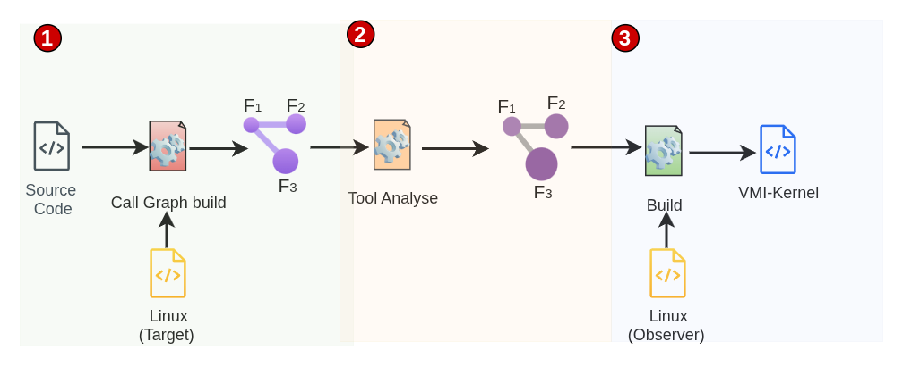

## VMI-Aware Observer Kernel

The idea is to build a customized kernel for the observer guest, tailored to the needs of its introspection application. We propose a compilation toolchain that takes the application source code and the kernel source code as input and produces a customized kernel. This kernel includes standard Linux kernel functions for the observer and VMI-aware function variants for the target.

<p align="center">
  
</p>

### 1. Build the call graph

The tool analyzes the introspection application's source code and builds a call graph to identify the kernel functions it requires. The process consists of three steps:

1. Generate LLVM intermediate representation (IR) for the application and the kernel.

2. Link the two IR modules.

3. Run an LLVM pass to analyze the linked IR and build the call graph.

### 2. Generate VMI-aware function variants

For each function in the call graph, we plan to generate a VMI-aware variant from its implementation in the kernel source code. The tool currently classifies functions; the next step is to implement the generation algorithms for C1 and C2.

We define the following classes and their intended transformations:

**C0: Functions with no parameters that use only constants and local variables.** These functions have no dependencies on external state and no side effects, including through functions they call.

**C1: Functions that use at least one of their parameters in their body.** Parameters that point to target memory are marked. After these markings are propagated, memory accesses through the marked pointers are translated.

```C
/**
 * task_prio - return the priority value of a given task.
 * @p: the task in question.
 *
 * Return: The priority value as seen by users in /proc.
 *
 **/
int task_prio(const struct task_struct *p)
{
	return p->prio - MAX_RT_PRIO;
}


/**
 * task_prio is a C1 function.
 * The proposed VMI-aware variant is shown below.
 **/
int task_prio_obs(const struct task_struct *p, vmi_t *vmi)
{
	return tgva_to_okva(p, vmi)->prio - MAX_RT_PRIO;
}
```

**C2: Functions that reference at least one global variable in their body.** The algorithm for this class should first resolve each referenced global variable's virtual address in the target using its name, then apply pointer analysis as for C1 functions.

For example, the `for_each_process` macro references the global variable `init_task`:

```C
#define for_each_process(p) \
	for (p = &init_task; (p = next_task(p)) != &init_task; )
```

The macro is expanded before LLVM IR analysis. In the expanded code, each reference to `&init_task` is replaced with a lookup of its virtual address in the target kernel:


```C
/* Proposed transformation, shown as C pseudocode. */
for (p = (struct task_struct *)resolve_target_symbol("init_task", vmi);
     (p = next_task(p)) !=
         (struct task_struct *)resolve_target_symbol("init_task", vmi); ) {
	/* Original loop body. */
}
```

Here, `resolve_target_symbol` is an illustrative helper that returns the target virtual address.

#### Testing

The test folders contain an example Linux kernel module (LKM), written as a VMI application and tested inside the target VM. **The goal is to build the module's call graph and classify all the kernel functions it uses into the classes defined above.**

To build the call graph and determine the class of each function, run:

```bash
./run.sh module-list --skip-link
```

#### Analyze the results

For each LKM test, the pass and test runner write the following files to a dedicated subdirectory under `artefact`:

- `graph.text`: Call relationships in `[caller]:[callee1],[callee2]` format.

- `classification.text`: Classification of each analyzed function in `[function]: labels; reasons` format. Labels indicate parameter use (`C1`), global-variable use (`C2`), or both. Functions with an available definition that fall into neither C1 nor C2 are assigned to C0 by default.

- `status.text`: Test results indicating whether the generated call graph matches the patterns specified by FileCheck directives in the test source code.


### Next Steps

- Implement and test the generation algorithms for C1 and C2 functions.
- Test additional real-world VMI applications and identify any additional function classes needed.
